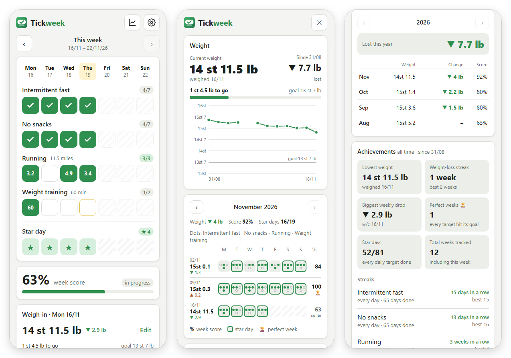

# Tickweek

Tick the boxes, lose the weight.

A small self-hosted health tracker: configurable daily targets (fasting, no snacks, exercise…) ticked on a weekly
Mon–Sun grid, a Monday weigh-in, and a light game layer (week score, perfect weeks, streaks, weight-loss streak, lowest
weight). It replaces a printed spreadsheet.

<picture>
  <source media="(prefers-color-scheme: dark)" srcset="docs/screenshots/screens-dark.png">
  
</picture>

<sub>Screenshots use made-up demo data (`npm run demo`).</sub>

One small Docker container with a SQLite file. Single user, no login: meant for a private network (LAN/VPN), not
the open internet.

**Status:** v1 built and tested locally, 16 Nov 2026 (This week, History, Settings, game layer, home-screen icon). Not released yet.

## Run it locally

```sh
npm install
npm start          # http://localhost:3000, data in ./data/tickweek.db (git-ignored)
npm run dev        # same, restarts on file changes
npm test           # node:test: domain logic, stats + API against an in-memory DB
npm run demo       # try it with ~12 weeks of made-up data (./demo-data, git-ignored)
```

Env: `PORT` (3000), `DATA_DIR` (`./data`; `/data` in the container), `APP_TZ` (`Europe/London`).
Dev/demo only: `TICKWEEK_NOW` pins the clock (e.g. `2026-11-19T19:30:00Z`) for screenshots; leave it unset.

## Layout

| Path | What |
|---|---|
| `src/server.js` | Entry: opens the DB, starts Express, closes cleanly on SIGTERM (WAL checkpoint before the backup) |
| `src/app.js` | Express app + JSON API (`/api/week`, `/api/history`, `/api/entry`, `/api/weigh-in`, `/api/targets`, `/api/settings`), `/health` |
| `src/db.js` | Schema, numbered migrations (`PRAGMA user_version`), queries, week snapshots |
| `src/dates.js`, `src/weight.js`, `src/scoring.js` | Pure domain logic (`weight.js` is also served to the browser) |
| `src/stats.js` | Game layer: streaks, weight-loss streak, star days, records (computed, never stored); `/api/history` |
| `public/` | Plain HTML/CSS/JS frontend: `index.html` (This week), `history.html`, `settings.html` |
| `scripts/demo-seed.js` | Fills a separate demo DB with made-up data (refuses a DB that already has weigh-ins) |
| `Dockerfile` | `node:24-slim`, data volume `/data`, port 3000, healthcheck on `/health` |

| Doc | What |
|---|---|
| [docs/design.md](docs/design.md) | The v1 spec: platform, targets, weight, scoring, screens, data model |
| [docs/backlog.md](docs/backlog.md) | Open items, next first |
| [docs/changelogs/](docs/changelogs/) | What changed, by month |
