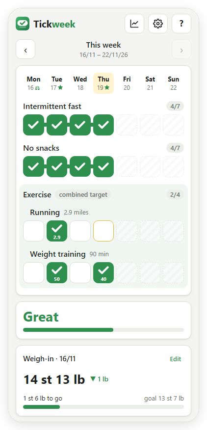
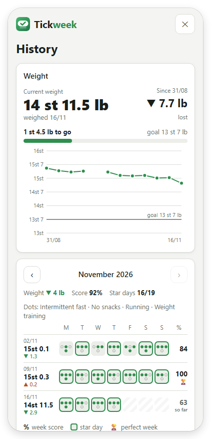
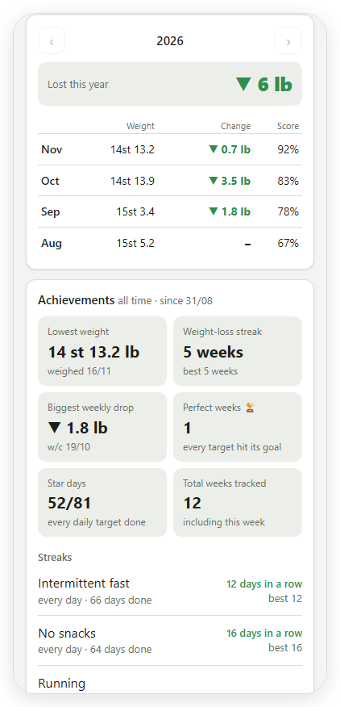
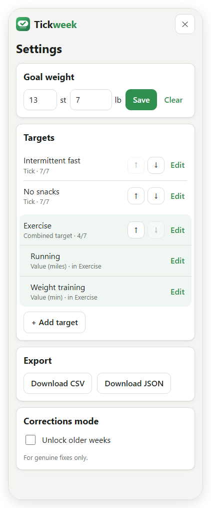
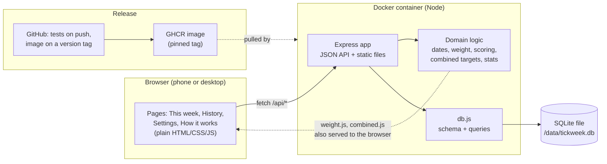

# Tickweek

**Tick the boxes, lose the weight.**

Tickweek turns your health goals into a week you can see. Pick a handful of daily targets (fast, skip the snacks,
run three times a week), tick them off as you go, and step on the scales every Monday. Small wins add up to streaks,
star days and perfect weeks, and your weight comes down along the way.

## Why it works

Most diets don't fail on knowledge. They fail on the gap between Monday's good intentions and Thursday evening.
Tickweek is built around a few simple ideas for closing that gap:

- **Make progress visible.** A ticked box is a small, immediate reward. A row of them is a chain you won't want to
  break. That's the whole point of the grid.
- **Measure behaviour daily, results weekly.** You control what you do today, not what the scales say tomorrow.
  So you track the habits every day and the weight once a week.
- **Weigh in on Monday.** Weekends are where plans slip. A Monday weigh-in means the scales judge your weekend while
  you still remember it, and a single weekly number shows the real trend without the day-to-day noise of water and
  salt.
- **Set goals you can actually hit.** Each target asks for a number of days a week: fasting every day, running three
  times, weights twice. Overdoing one doesn't make up for skipping another, so the week score rewards balance.
- **Keep the game light.** Streaks, star days and perfect weeks give you something to protect and something to aim
  for. No points, levels or badges to manage. The goal stays the goal.

## A quick tour

<table>
<tr>
<td width="300" valign="top">

<picture>
  <source media="(prefers-color-scheme: dark)" srcset="docs/screenshots/this-week-dark.png">
  
</picture>

</td>
<td valign="top">

### This week

**Your daily check-in.** Open it once a day, ideally in the evening, and tick what you did.

- Tap a box to tick a target. Value targets (running, weights) ask for the miles or minutes.
- Missed a day? Fill it in any time this week. Last week stays open until you weigh in.
- A ★ appears next to the date on a **star day**: every target with a goal done that day.
- Underneath: how the week's going in a word (On track, Great, Catch-up time…), the Monday weigh-in and the streaks you're keeping alive.

</td>
</tr>
<tr>
<td valign="top">

<picture>
  <source media="(prefers-color-scheme: dark)" srcset="docs/screenshots/history-dark.png">
  
</picture>

</td>
<td valign="top">

### History

**The bigger picture.** Check it after your Monday weigh-in.

- Your current weight, how much you've lost since you started and how far is left to your goal.
- A weekly weight chart with your goal line.
- One month at a time: each week's row shows a dot per target per day, the weigh-in and the week score.
  Ringed days are star days, 🏆 marks a perfect week. Tap a week to open it.

</td>
</tr>
<tr>
<td valign="top">

<picture>
  <source media="(prefers-color-scheme: dark)" srcset="docs/screenshots/year-dark.png">
  
</picture>

</td>
<td valign="top">

### Year and achievements

**What you've built.** Scroll further down History.

- The year at a glance: weight at the end of each month, the change and the average score.
- Achievements: lowest weight, weight-loss streak, biggest weekly drop, perfect weeks, star days.
- Streaks for every target, with your best so far, so you know exactly what's at stake today.

</td>
</tr>
<tr>
<td valign="top">

<picture>
  <source media="(prefers-color-scheme: dark)" srcset="docs/screenshots/settings-dark.png">
  
</picture>

</td>
<td valign="top">

### Settings

**Make it yours.** Set it up once, adjust as you go.

- Add your targets: a simple tick, or a value with a unit. Say how many days a week each one asks for.
- Combine targets: Exercise 4 days a week, done by either a run or a weights session.
- Rename, reorder or retire them at any time. Changes apply from this week on; past weeks keep their scores.
  A retired target can also be deleted for good.
- Set a goal weight to see your progress towards it.
- Export your data any time: CSV (one row per day, opens in a spreadsheet) or JSON (everything).

</td>
</tr>
</table>

<sub>Screenshots use made-up demo data. There's also a built-in **How it works** page behind the **?** button.</sub>

## Also

- **Built for your phone**: add it to your home screen and it opens like an app. Light and dark mode follow your
  device.
- **Private by design**: it runs on your own hardware. No account, no cloud, no ads, no tracking. Your weight stays
  yours.
- **Stone and pounds**: weight shown in st/lb (stored in kg underneath), weeks start on Monday, dates are dd/mm.

## Run it

Tickweek is a single small Docker container with one SQLite file. It's designed for a home network or VPN: there's
no login, so don't expose it to the internet.

```sh
docker run -d --name tickweek \
  -p 3000:3000 \
  -v /path/to/tickweek-data:/data \
  -e TZ=Europe/London \
  ghcr.io/ajyounguk/tickweek:0.9.0
```

Then open `http://<your-server>:3000`, and on your phone use **Add to Home Screen**. Pin a version tag as above and
upgrade on purpose. Images are published per release; there's no `:latest`.

Versions before 0.6 used an older database layout. 0.6 won't open it (it says so and stops): start with an empty
`/data` folder, or move the old `tickweek.db` aside.

To back up, copy the `/data` folder while the container is stopped (it shuts down cleanly on `docker stop`).

## Develop

Node 22+ (the image runs Node 26). Express, `better-sqlite3`, plain HTML/CSS/JS. No build step.

```sh
npm install
npm start          # http://localhost:3000, data in ./data/tickweek.db (git-ignored)
npm run dev        # same, restarts on file changes
npm test           # node:test: domain logic, stats + API against an in-memory DB
npm run demo       # try it with ~12 weeks of made-up data (./demo-data, git-ignored)
```

Env: `PORT` (3000), `DATA_DIR` (`./data`; `/data` in the container), `APP_TZ` (`Europe/London`).
Dev/demo only: `TICKWEEK_NOW` pins the clock (e.g. `2026-11-19T19:30:00Z`) for screenshots; leave it unset.

### Architecture



| Path | What |
|---|---|
| `src/server.js` | Entry: opens the DB, starts Express, closes cleanly on SIGTERM (WAL checkpoint before any backup) |
| `src/app.js` | Express app + JSON API (`/api/week`, `/api/history`, `/api/entry`, `/api/weigh-in`, `/api/targets`, `/api/settings`, `/api/export.csv`, `/api/export.json`), `/health` |
| `src/db.js` | Schema (versioned with `PRAGMA user_version`; another version is refused, not migrated), starting targets, queries, week snapshots |
| `src/dates.js`, `src/weight.js`, `src/scoring.js`, `src/combined.js` | Pure domain logic (`weight.js` and `combined.js` are also served to the browser) |
| `src/export.js` | Data export: JSON (everything, weight in kg) and CSV (one row per day, one column per target) |
| `src/stats.js` | Game layer: streaks, weight-loss streak, star days, records (computed, never stored) |
| `public/` | Frontend: `index.html` (This week), `history.html`, `settings.html`, `help.html` (How it works) |
| `scripts/demo-seed.js` | Fills a separate demo DB with made-up data (refuses a DB that already has weigh-ins) |
| `Dockerfile` | `node:26-slim`, data volume `/data`, port 3000, healthcheck on `/health` |

| Doc | What |
|---|---|
| [docs/design.md](docs/design.md) | The spec: targets, weight, scoring, screens, data model |
| [docs/backlog.md](docs/backlog.md) | Open items, next first |
| [docs/changelogs/](docs/changelogs/) | What changed, by month |

## License

[MIT](LICENSE)
